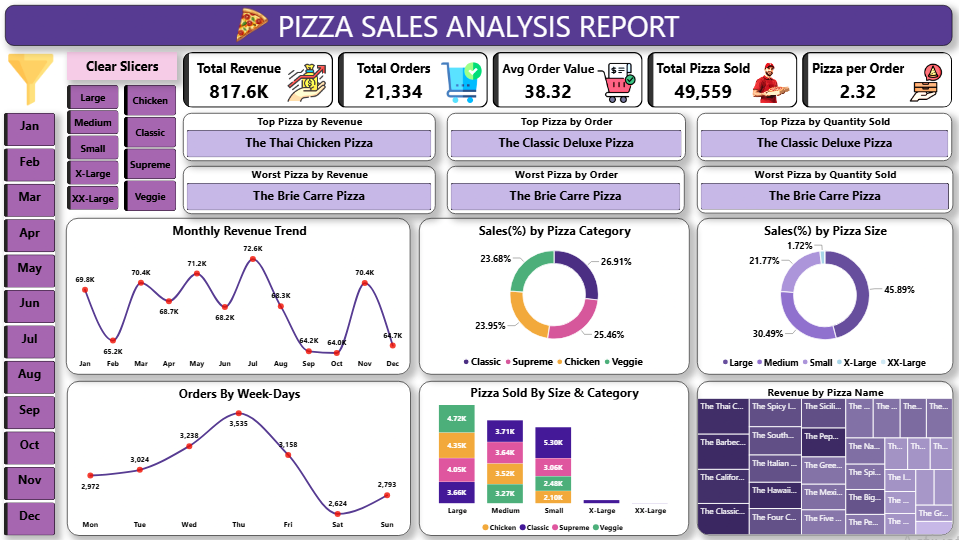

# 🍕 Pizza Sales Analysis Dashboard

An interactive Power BI dashboard analyzing a full year of pizza restaurant sales — revenue, orders, best and worst sellers, category and size performance, and weekday and monthly trends — built to help the business decide what to promote, what to review, and when to staff up.



---

## 🎯 Business Problem
A pizza restaurant needs to understand where its revenue actually comes from:
- Which pizzas, categories, and sizes drive the most revenue?
- Which menu items are underperforming and worth reviewing?
- Which days and months are busiest, so staffing and promotions can be planned?
- How much does a typical customer order, and how big is the average bill?

This dashboard turns 48,606 order-line records into one interactive view that managers can filter by month, size, and category.

---

## 🔧 Tools & Skills Used
- **Power BI Desktop** — data modeling, report design
- **DAX** — custom measures for revenue, orders, average order value, and basket size
- **Data Visualization** — KPI cards, line charts, donut charts, stacked columns, treemap
- **Interactive Filtering** — month, size, and category slicers with a clear-all button
- **Dashboard Design** — consistent color logic (one color per category across charts)

---

## 📐 DAX Measures
```dax
Total Revenue = SUM('PIZZA SALES'[total_price])

Total Orders = DISTINCTCOUNT('PIZZA SALES'[order_id])

Avg Order Value = DIVIDE([Total Revenue], [Total Orders])

Total Pizza Sold = SUM('PIZZA SALES'[quantity])

Pizza per Order = DIVIDE([Total Pizza Sold], [Total Orders])
```

---

## 📊 Key Insights
- **817.6K total revenue** from **21,334 orders**, with an average order value of **38.32** and **2.32 pizzas per order**
- **Large pizzas generate 45.89% of revenue.** X-Large and XX-Large together contribute under 2%, making them candidates for a menu review
- **Categories are well balanced:** Classic leads at 26.91%, followed by Supreme (25.46%), Chicken (23.95%), and Veggie (23.68%). No single category dominates
- **Thursday is the busiest day (3,535 orders) and Saturday the quietest (2,624)**, roughly a quarter fewer orders, which is useful for staffing and promotion timing
- **Monthly revenue is steady**, ranging only from 64.0K (October) to 72.6K (July)
- **The Thai Chicken Pizza earns the most revenue**, while **The Classic Deluxe Pizza leads in orders and quantity sold**
- **The Brie Carre Pizza is the weakest performer on revenue, orders, and quantity**, a clear candidate for menu review

---

## 📁 Dataset
A publicly available pizza restaurant practice dataset, containing 48,606 order-line records from January to December 2025, with order date and time, pizza name, category, size, quantity, and price.

---

## 📷 Preview
See `Pizza_Sales_Dashboard.png` in this repo for a full dashboard screenshot.

---

## 👤 Author
**Bikram Ghosh** — Data Analyst & BI Consultant
[LinkedIn](https://linkedin.com/in/bikram-ghosh1996721b9)
